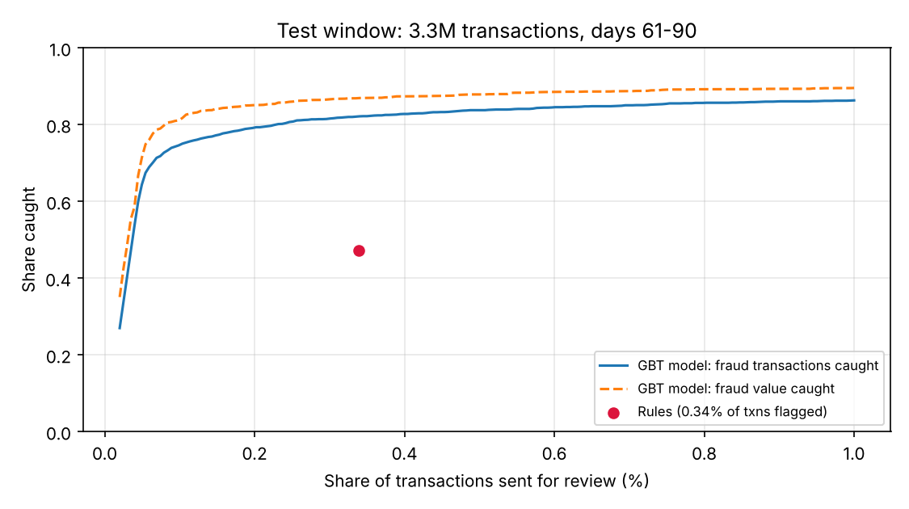

# Card Fraud Analytics at Scale (PySpark)

[](https://github.com/Drakeion2532/card-fraud-analytics-spark/actions/workflows/tests.yml)

An end-to-end fraud pipeline on **10 million card transactions** (200,000 cardholders, 90 days) in PySpark: **Hive tables** partitioned by day, behavioural attributes written as **Spark SQL window functions**, a **Spark MLlib gradient-boosted model**, a head-to-head comparison against fraud rules **at the same alert budget**, and **HiveQL business queries** that turn model scores into review workload and losses prevented.



## Headline results (test window: days 61–90, 3.3M transactions, 0.08% fraud)

Both approaches flag the same **0.34% of transactions** for review:

| | Rules | GBT model |
|---|---|---|
| Fraud transactions caught | 47.2% | **82.2%** |
| Fraud value caught | 53.8% | **86.9%** |
| Precision (alerts that are fraud) | 10.2% | **17.7%** |
| Compromised cards caught | 73.1% | **93.5%** |
| Median fraud txns before first alert | 2 | **1** |

**At tighter review budgets:** reviewing just 0.1% of transactions catches 74.8% of fraud transactions and 81.3% of fraud value at 54.5% precision. Overall ROC-AUC is 0.976 and PR-AUC is 0.746, against a 0.08% base rate.

**By fraud style** (at the rules' alert volume): burst 91%, card-testing 96%, stealth 38%. The rules catch **0%** of stealth fraud, which only shows up as a shift in the card's own behaviour.

## Business view (HiveQL, `insights.sql`)
What a fraud-strategy lead would ask, answered from the Hive tables:

- **Losses prevented (30-day test window):** at a 0.2% review budget the model stops **₹77.7L of ₹91.4L** fraud value (85%). The rules stop ₹49.2L (54%), so the model stops **₹28.6L more while raising 40% fewer alerts** (0.2% vs 0.34% of transactions).
- **Review workload:** about **215 alerts a day** (peak 267), of which **29% are real fraud**. That's a staffing number an operations team can plan around.
- **Where rules fail:** stealth fraud. The rules stop 0% of its value and the model 27%. For burst fraud the figures are 58% vs 90%; for card-testing, 75% vs 97%.
- **Where fraud concentrates:** electronics is 0.3% of spend but 21% of fraud value. Online foreign transactions run at 665 bps fraud vs 2.8 bps for in-store domestic. These patterns come from how the data was simulated, so treat them as a demonstration of the query, not a finding.

**Runtime** on a 2-core, 7 GB machine (Spark local mode): features in 65s, training in 85s, scoring 3.3M rows in 30s.

## Pipeline
1. **`generate_data.py`:** simulates 10M transactions in Spark and writes Parquet partitioned by `txn_date`. Legitimate spend varies by card (typical amount, online habit, merchant mix, daytime-heavy hours). Look-alike noise is included on purpose: travel spend abroad, occasional large purchases, online sprees. About 1,000 cards (0.5%) are compromised, with three fraud styles:
   - **burst:** rapid high-value online spending, often foreign
   - **card test:** several tiny charges within minutes
   - **stealth:** amounts and channels that match the cardholder's normal behaviour
2. **`features.sql`:** per-card features that use only past activity, via `RANGE BETWEEN … PRECEDING` windows:
   - velocity: transactions and spend in the last 1h and 24h, small charges in the last hour, seconds since the previous transaction
   - the card's 30-day baseline: average amount and z-score, online and foreign rates, and how surprising this transaction is against them
3. **`train_model.py`:**
   - **Time-based split:** train on days 1–60, test on days 61–90.
   - **Merchant-category risk:** smoothed target encoding, learned on training days only.
   - **Model:** Spark MLlib `GBTClassifier`, trained with legitimate rows down-sampled to 5% and all fraud kept.
   - **Evaluation:** the model is compared with a typical rule set at the **same alert volume**, then at fixed review budgets of 0.1%, 0.2% and 0.5%, with transaction-level, value-level and card-level metrics.
4. **`insights.py` + `insights.sql`:** loads transactions, features and test scores into a Hive metastore as database `fraud` (`transactions` and `txn_features` partitioned by `txn_date`, 91 partitions), then answers the business questions above in HiveQL. Results go to `results/insights.json`.

**Top features (GBT importance):** 1-hour velocity (0.32), hour of day (0.12), 24-hour velocity (0.09), merchant-category risk (0.08), time since previous transaction (0.07), 24-hour spend vs the card's average (0.06), foreign surprise (0.06).

## Limits (say these before you're asked)
- **Synthetic data.** I wrote both the fraud patterns and the features, so the model has an easier job than on real data. The numbers show the method and the scale, not real-world fraud performance.
- **Hour of day ranks high** because legitimate spend was simulated as daytime-heavy while fraud is spread evenly. Real fraud timing is messier.
- **Single machine.** This is Spark in local mode. The same code runs on a cluster, but this project doesn't demonstrate cluster tuning.
- **Labels arrive instantly here.** Real chargebacks arrive weeks later, which delays training data. There is also no cost model per alert or per missed fraud yet; [credit-default-scorecard](https://github.com/Drakeion2532/credit-default-scorecard) shows that approach.

## Run it
Needs Python 3.10+ and Java 17 or 21.
```bash
pip install -r requirements.txt
python generate_data.py data/tx 10000000      # ~10M rows, about 190 MB of Parquet
python train_model.py data/tx data/work        # writes results/results.json and the chart
python insights.py data/tx data/work           # Hive tables + business queries -> results/insights.json
pytest -q                                      # checks the SQL features on a hand-made card history
```
Use a smaller first argument (e.g. `200000`) for a quick test run.
